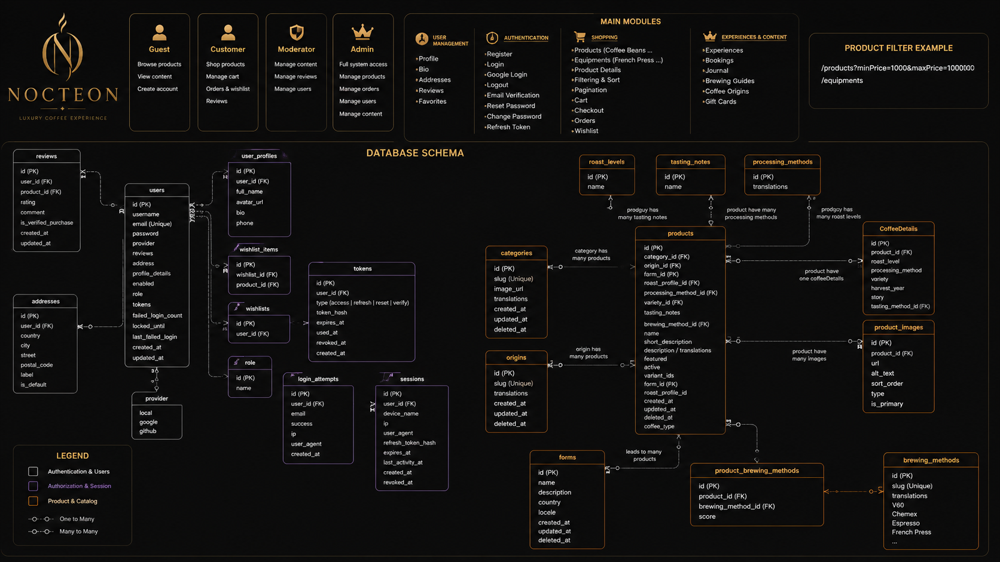

<div align="center">


# NOCTEON COFFEE

### Luxury Coffee Experience Platform

Enterprise-grade backend powering a premium specialty coffee experience.


</div>

---

# ☕ About

Nocteon Coffee is not a traditional e-commerce application.

It is a **Luxury Coffee Experience Platform** built to provide:

- Specialty Coffee Commerce
- Educational Coffee Content
- Brewing Guides
- Premium Customer Experiences
- Memberships & Loyalty
- Gift Cards
- Future Booking Experiences

The backend is built using **Spring Boot** following modern software engineering principles and production-ready practices.

---

# 🏛 System Architecture

<div align="center">

</div>

---

# ✨ Features

## 🔐 Authentication

- JWT Authentication
- Refresh Token Rotation
- RSA Signing Keys
- Email Verification
- Password Reset
- Change Password
- Google OAuth2 Login
- Logout & Session Management
- Account Lock Protection
- Rate Limiting

---

## 👤 User Management

- User Profiles
- Multiple Addresses
- Favorites & Wishlist
- Reviews
- Session Tracking

---

## 🛒 Shopping

- Coffee Products
- Equipment Products
- Product Variants
- Product Images
- Filtering & Pagination
- Shopping Cart
- Checkout
- Orders Management

---

## 🌍 Internationalization

Translation support for:

- Products
- Categories
- Origins
- Farms
- Roast Profiles
- Processing Methods
- Coffee Varieties
- Tasting Notes
- Brewing Methods
- Journal Categories
- Journal Posts

---

## 📝 Content System

- Coffee Journal
- Brewing Guides
- Coffee Origins
- Rich Articles

---

## 🚀 Future Features

- Experiences
- Membership Program
- Gift Cards
- Loyalty System
- Booking System

---

# 🏗 Architecture & Design Principles

- Clean Architecture
- SOLID Principles
- Domain Driven Design (DDD)
- RESTful API Design
- DTO Pattern
- Repository Pattern
- Service Layer Pattern
- Global Exception Handling
- Validation Layer
- Multi-language Architecture

---

# 🛠 Tech Stack

| Technology | Version |
|------------|----------|
| Java | 21 |
| Spring Boot | 3.x |
| Spring Security | Latest |
| Spring Data JPA | Latest |
| PostgreSQL | 16 |
| Redis | 7 |
| Docker | Latest |
| Maven | Latest |
| JWT | Latest |
| Cloudinary | Latest |
| MapStruct | Latest |
| Lombok | Latest |

---

# 📦 Modules

```text
Authentication
Users
Profiles
Addresses
Products
Categories
Origins
Farms
Roast Profiles
Processing Methods
Coffee Varieties
Tasting Notes
Brewing Methods
Cart
Wishlist
Orders
Reviews
Journal
```

---

# 🗄 Database Highlights

### User Domain

- Users
- User Profiles
- Addresses
- Sessions
- Tokens
- Login Attempts

### Product Domain

- Products
- Variants
- Categories
- Origins
- Farms
- Coffee Details
- Product Images
- Brewing Methods
- Reviews

### Content Domain

- Journal Categories
- Journal Posts
- Product Articles

---

# 🔒 Security Features

✅ JWT Authentication

✅ RSA Key Signing

✅ Refresh Token Rotation

✅ Session Management

✅ Email Verification

✅ Password Reset Flow

✅ Account Locking

✅ Password Encryption (BCrypt)

---

# 🚀 Getting Started

## Clone Repository

```bash
git clone https://github.com/vemonser/nocteon-coffee-backend.git
cd nocteon-coffee-backend
```

---

## Environment Variables

Create:

```bash
.env
```

Example:

```env
DB_URL=
DB_USERNAME=
DB_PASSWORD=

REDIS_HOST=
REDIS_PORT=
REDIS_PASSWORD=

JWT_ACCESS_EXPIRATION=
JWT_REFRESH_EXPIRATION=

MAIL_USERNAME=
MAIL_PASSWORD=

GOOGLE_CLIENT_ID=
GOOGLE_CLIENT_SECRET=

CLOUDINARY_CLOUD_NAME=
CLOUDINARY_API_KEY=
CLOUDINARY_API_SECRET=
```

---

## Run Infrastructure

```bash
docker compose up -d
```

This brings up four services:

| Service | Image | Purpose |
|---|---|---|
| `db` | `pgvector/pgvector:pg16` | Postgres **with the `vector` extension**. Not the vanilla image — semantic search needs pgvector and it cannot be installed on an existing cluster without superuser. |
| `redis` | `redis:7-alpine` | Sessions, rate limits, chat history. |
| `ollama` | `ollama/ollama:latest` | Local model inference. |
| `ollama-init` | `ollama/ollama:latest` | One-shot. Pulls both models into the `ollama-data` volume, then exits. Nothing depends on it, so a failed pull never blocks the other services; re-run it with `docker compose run --rm ollama-init`. |

The application itself is **not** a compose service — run it from the host with
`./mvnw spring-boot:run` (below), so a code change is a rebuild rather than a container
rebuild.

### GPU

The `ollama` service carries a `deploy.resources.reservations.devices` block for the NVIDIA
container toolkit. If Ollama starts and shows no GPU, delete that block: it falls back to CPU
inference, which is correct but slow enough to matter (see the load numbers in
[docs/ai-golden-queries.md](docs/ai-golden-queries.md)).

---

## Run Application

```bash
./mvnw spring-boot:run
```

or

```bash
mvn spring-boot:run
```

---

# 🤖 AI Features

Semantic product search, a "similar products" rail, and a bilingual coffee shopping
assistant. **All of it is off by default** — an existing deployment that sets nothing new
behaves exactly as it did before.

## Quickstart

```bash
# 1. Infrastructure, including the two model downloads (~2 GB, one time)
docker compose up -d

# 2. Confirm the models landed
docker compose exec ollama ollama list
#   nomic-embed-text:latest
#   qwen2.5:3b-instruct:latest

# 3. Run the app (AI flags still off)
AI_ENABLED=true ./mvnw spring-boot:run

# 4. Build the index
curl -X POST http://localhost:8080/api/dashboard/ai/reindex -H "Authorization: Bearer $ADMIN_TOKEN"
curl http://localhost:8080/api/dashboard/ai/stats    -H "Authorization: Bearer $ADMIN_TOKEN"
#   indexed > 0, then stale: 0
```

## The order the flags go up in

The order is load-bearing. Each step depends on the one before it, and turning them on out
of sequence costs you either a 503 or an empty index.

| Step | Set | Why it comes here |
|---|---|---|
| 1 | `AI_ENABLED=true` | Master switch. Nothing works without it — the other two are ANDed with it, so neither alone does anything. Boots and connects to Ollama. |
| 2 | *(index the catalog)* | `/api/dashboard/ai/reindex` with an admin token. With search still off this is the only way to write to the store, which is deliberate: an admin must be able to repair an index the search flag turned off. Expect `stale: 0` from `/stats`. |
| 3 | `AI_SEARCH_ENABLED=true` | Vector ranking on `GET /api/products?semantic=true`, and the vector path of `/products/{slug}/similar`. Useless before step 2 — the store is empty. |
| 4 | `AI_CHATBOT_ENABLED=true` | `POST /api/ai/chat`. Last, because the assistant quotes slugs that come from step 3's ranking. |

Down is the reverse and needs no ceremony — see [Rollback](#rollback).

```bash
AI_ENABLED=true AI_SEARCH_ENABLED=true AI_CHATBOT_ENABLED=true ./mvnw spring-boot:run
```

| Flag | Default | Endpoint |
|---|---|---|
| `AI_ENABLED` | `false` | Master switch for everything below. |
| `AI_SEARCH_ENABLED` | `false` | `GET /api/products?semantic=true`, vector path of `/products/{slug}/similar` |
| `AI_CHATBOT_ENABLED` | `false` | `POST /api/ai/chat`, `GET /api/ai/chat/history`, `DELETE /api/ai/chat/session` |
| `OLLAMA_BASE_URL` | `http://localhost:11434` | Point at a model host other than the compose service. |
| `MAIL_SCHEDULING_ENABLED` | `false` | Unrelated to AI, but ships default-off for the same reason: enabling it starts sending real email. |

## Models and what they cost

| Model | Size | Purpose |
|---|---|---|
| `nomic-embed-text` | 274 MB | Embeds product documents and queries. **768 dimensions**, which is what the `vector(768)` column is declared as — changing the model without changing `spring.ai.vectorstore.pgvector.dimensions` fails on the first insert. |
| `qwen2.5:3b-instruct` | 1.9 GB (2.0 GB resident, Q4_K_M) | The shopping assistant. |

Both are held in memory while Ollama has them loaded. About **2.3 GB of RAM** for the pair,
more if both stay resident. VRAM, if a GPU is present: the same ~2.3 GB.

The embedding model is cheap — a few milliseconds per document on CPU, and it runs only at
index time. **The chat model is the expensive one, and it runs per visitor message.** On a
CPU-only host it does not meet a 3-second target at any realistic concurrency; measured p95
was 49 seconds at 50 concurrent sessions on a 6-core Ryzen 5 4600H. The numbers and the
hardware are in [docs/ai-golden-queries.md](docs/ai-golden-queries.md). Give Ollama a GPU
before you put the assistant in front of real traffic.

## Rollback

Flip the flags off. Nothing else is required — no migration to revert, no data to clean up,
no deploy of a previous build.

```bash
AI_ENABLED=false ./mvnw spring-boot:run
```

| Concern | What actually happens |
|---|---|
| Search | `semantic=true` is ignored; `GET /api/products` returns keyword results exactly as before the feature existed. |
| Similar products | `GET /products/{slug}/similar` keeps returning 200, ranked by attribute overlap instead of vector similarity, with a localized reason on every entry. Verified live, both languages. |
| Chatbot | `POST /api/ai/chat` returns **503** with a localized "AI features are temporarily unavailable", not a degraded or invented answer. The endpoint is public, so 503 is the honest signal for a client polling for availability. |
| The vector store | Left in place. The `vector_store` table and its HNSW index cost one table and are harmless; dropping them would mean a migration to undo a rollback. |
| Ollama | Can go down entirely. `pull-model-strategy: never` means the app never calls Ollama at startup, and every AI path degrades rather than failing a request. |

The one thing rollback does **not** undo is the assistant's conversation history, which sits
in Redis under `ai:chat:*` with a 30-minute TTL and expires on its own.

## Known limitations

Recorded from a live verification run, not from intent:

- **The 3B model invents coffees.** Told the catalog had no match, `qwen2.5:3b-instruct`
  recommends coffees that do not exist — including, once, a fabricated product slug
  (`slatka-9`) in a customer-facing reply. The prompt forbids it; on this model it does not
  hold. Nothing in the response tells a client the name is invented. Do not ship the
  assistant to real visitors without a larger model.
- **Arabic chat does not function.** Ollama returns an empty completion for Arabic prompts
  under the production system prompt; the endpoint returns its degraded apology. Arabic
  *search* and Arabic *similar-product* reasons are fine.
- **The semantic round trip was never integration-tested** against a live pgvector on the
  machine this was verified on — the available Postgres has no `vector` extension. The
  degradation path (vector store unreachable → keyword search, no 5xx) *is* verified. Run
  the golden-query set in [docs/ai-golden-queries.md](docs/ai-golden-queries.md) against a
  real pgvector host before trusting the ranking.

## Load check

```bash
k6 run --scenario search docs/ai-load.js    # 200 requests @ 10 VUs
k6 run --scenario chat   docs/ai-load.js    # 50 VUs for 2 minutes
```

`RateLimitFilter` caps anonymous traffic at 200 requests/minute **per IP**, and it reads
`X-Real-IP` when present. The script varies that header per VU; if you write your own load
run and don't, you will measure 429s rather than the endpoint.

## Troubleshooting

| Symptom | Cause |
|---|---|
| Boot fails on `CREATE EXTENSION IF NOT EXISTS vector` | The database is not the `pgvector/pgvector` image, or `V103__enable_pgvector.sql` has not been applied. Needs superuser; it cannot be fixed from the application. |
| `/products/{slug}/similar` returns the same rail for every product | Expected while `AI_SEARCH_ENABLED=false` — that is the attribute fallback. |
| Search returns nothing with `semantic=true` | `AI_SEARCH_ENABLED` is on but the index is empty. Run `/api/dashboard/ai/reindex`. |
| Chat answers in 0.4 s with "taking a short break" | The model returned an empty completion. Check `ollama ps`; the most common cause is a prompt the model cannot tool-call against. |
| Everything works but `/actuator/health` returns 401 | Expected — actuator is behind authentication. It is not a sign the app is down. |

# 📬 API Documentation

```text
http://localhost:8080/swagger-ui/index.html
```

---

# 🧪 Running Tests

```bash
mvn test
```

---

# 📈 Project Goals

- Build a premium coffee ecosystem.
- Deliver a luxury digital experience.
- Support multilingual content.
- Follow enterprise-grade architecture.
- Scale for future experiences and memberships.

---

# 👨‍💻 Author

### AbdelRhman Samy

Frontend Developer • Backend Developer • Software Architect Enthusiast • Cybersecurity Enthusiast

---

<div align="center">

### Made with ❤️ and lots of ☕ by NOCTEON COFFEE

</div>
